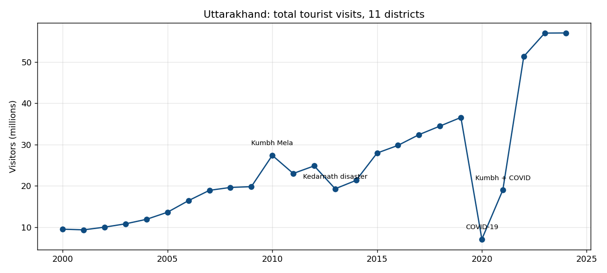
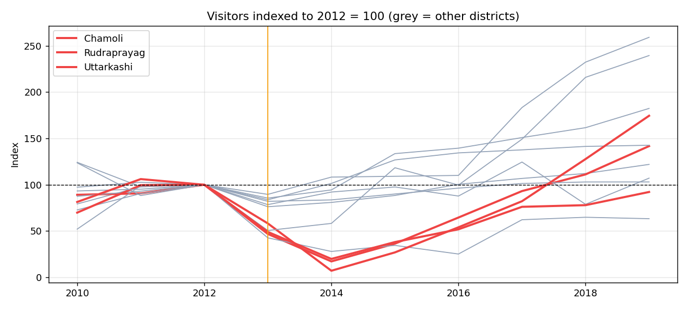
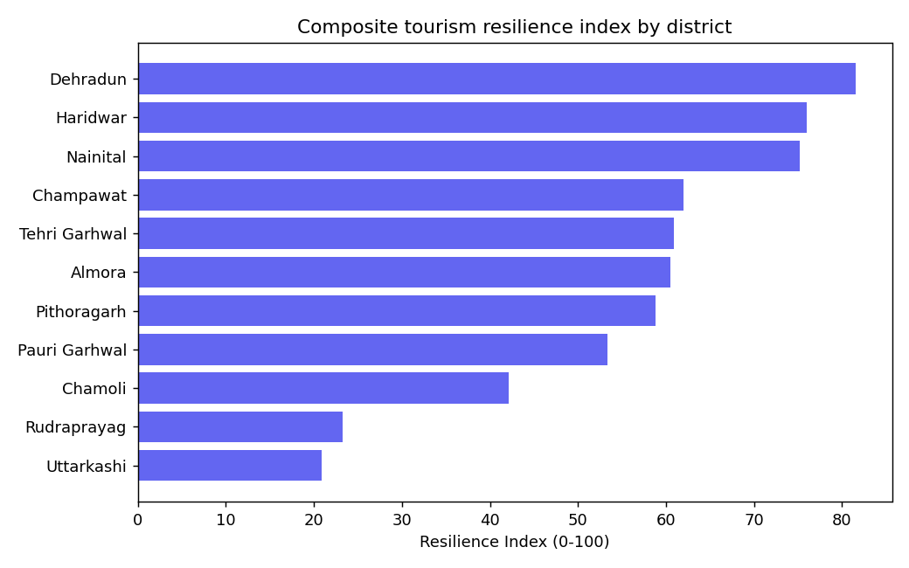

# Climate Resilience of Himalayan Tourism 🏔️📊

> How did climate disasters affect tourism across Uttarakhand's districts, and which districts recover fastest?

[](https://www.python.org/)
[](https://pandas.pydata.org/)
[](https://powerbi.microsoft.com/)
[](tests/)

A group data-analytics project (UPES). It combines **25 years of district tourism statistics**, **14 years of
gridded rainfall** and **state landslide records** for Uttarakhand, cleans them in a Python pipeline, analyses
the 2013 Kedarnath disaster and COVID-19 as natural experiments, and presents the results in Power BI.

---

## Key findings



1. **Kedarnath 2013 was a district-specific shock.** Visitors fell **93% in Rudraprayag**, 83% in Chamoli and 80% in
   Uttarkashi (2014 vs 2012), but only 14–16% in Dehradun and Haridwar. Rudraprayag took ~6 years and Uttarkashi
   ~7 years to get back to 90% of 2012 levels.

   

2. **COVID-19 hit everyone, and recovery was fast.** State visitors fell from 36.6M (2019) to 7.1M (2020). Most
   districts were back above 90% of 2019 by 2022; the state total reached 57M in 2023–24.

3. **Year-to-year rainfall barely explains tourism.** Across 121 district-years (COVID and Kumbh Mela years
   excluded), rainfall anomaly vs. visitor change gives Spearman ρ = −0.18 (p = 0.053). Excluding 2013,
   ρ = −0.01 (p = 0.88). The relationship is driven by one extreme event, not by ordinary wet years.
   **Extreme events matter; average rainfall doesn't.**

4. **The pilgrimage districts are the least resilient.** Composite index (0–100), top to bottom:
   Dehradun 82, Haridwar 76, Nainital 75 … Chamoli 42, Rudraprayag 23, Uttarkashi 21.

   

---

## Data

| File (`data/raw/`) | Content | Rows |
| --- | --- | --- |
| `uttarakhand_district_tourism.csv` | Indian / foreign / total visitors, 11 districts, 2000–2024 (Uttarakhand Tourism statistics) | 11 × 25 years |
| `uttarakhand_rainfall_summary.csv` | Mean daily rainfall per district-year from gridded data, 13 districts, 2011–2024 | 182 |
| `uttarakhand_landslide_events.csv` | State-level landslide counts for 9 years, with counting method | 9 |

The rainfall and landslide files were originally only on a teammate's machine; they were recovered from the
Power BI data model so the analysis is reproducible.

### Data-quality issues found and fixed (all recorded in a `Quality_Note` column)

- The tourism file was a CSV named `.xlsx`, so `pd.read_excel` failed. The old script then silently **generated
  random data**, and that random data was the "processed dataset". Now the pipeline stops with an error if data is missing.
- **Almora and Nainital rows were swapped for 2008–2010** (Almora jumped 6× and back). Swapped back.
- **2019 had no Total column**; rebuilt as Indian + Foreign and checked `Indian + Foreign = Total` for every row.
- **Rainfall "Total_Rainfall_mm" is summed over grid cells**, so it measures district area (Chamoli has 12 cells and
  Champawat 2). Annual rainfall is now computed as mean daily rainfall × days.
- **District names differ between sources** (`Hardwar` vs `Haridwar`, `Garhwal` vs `Pauri Garhwal`, …); harmonised,
  and the join now fails loudly if any district is unmatched.
- **Haridwar 2010 and 2021 spikes are the Kumbh Mela**: labelled as events, not "corrected".
- **Landslide counts mix methods** (a 1998 field-mapping inventory vs event counts), so they are never summed together.

---

## Method

1. **ETL** (`src/data_preprocessing.py`): reshape wide → long, clean, harmonise, validate, write tidy CSVs.
2. **Event study** (`src/analysis.py`): for each shock, drop % = trough ÷ pre-shock baseline − 1, and recovery year =
   first year back at ≥ 90% of baseline (2012 baseline for Kedarnath, 2019 for COVID).
3. **Correlation**: Spearman rank correlation between each district's rainfall anomaly (vs its own 2011–24 mean) and
   its visitor YoY change, excluding COVID and Kumbh years.
4. **Resilience index**: four components (2013 drop, 2013 recovery time, COVID drop, rainfall variability as CV),
   each min-max scaled, equal weights, 0–100.
5. **Dashboard**: Power BI (`dashboards/`). The original `.pbix` has modelling problems, documented in
   [`dashboards/POWER_BI_FIXES.md`](dashboards/POWER_BI_FIXES.md) with corrected DAX in `DAX_Measures_Library.dax`.

## How to run

```bash
pip install -r requirements.txt
python src/data_preprocessing.py   # writes data/processed/*.csv
python src/analysis.py             # event study, correlation, resilience index, figures
python -m pytest -q                # 10 tests
```

## Repository structure

```
├── data/
│   ├── raw/          # original sources (tourism, rainfall, landslides)
│   └── processed/    # cleaned tables + analysis outputs for Power BI
├── dashboards/       # .pbix, DAX measures, theme, fix guide
├── docs/             # group poster (PDF) and interview guide
├── reports/figures/  # charts generated by src/analysis.py
├── src/              # data_preprocessing.py, analysis.py
└── tests/
```

## Limitations

- Only 14 years of rainfall and 11 districts: correlations are weak evidence, and the index weights are a choice.
- Landslide data is state-level and inconsistent across years, so it can't be analysed per district.
- Tourism counts are official estimates (e.g. Rudraprayag 2000 is an exact 300,000).
- Visitor numbers are driven heavily by non-climate factors (pilgrimage calendars, COVID, road projects).

## Team

Group project for UPES, submitted to Dr. Sachi Chaudhary:
**Sneha Chaudhary** ([GitHub](https://github.com/scodes-byte) · [LinkedIn](https://linkedin.com/in/sneha-chaudhary-791b2a283)),
Hritvik Bhandari, Vishnu Choudhary, Kritika Gupta.
The Python pipeline, data-quality fixes, analysis and tests in this repository were added afterwards as an extension of the group work.

## License

MIT, see [LICENSE](LICENSE).
